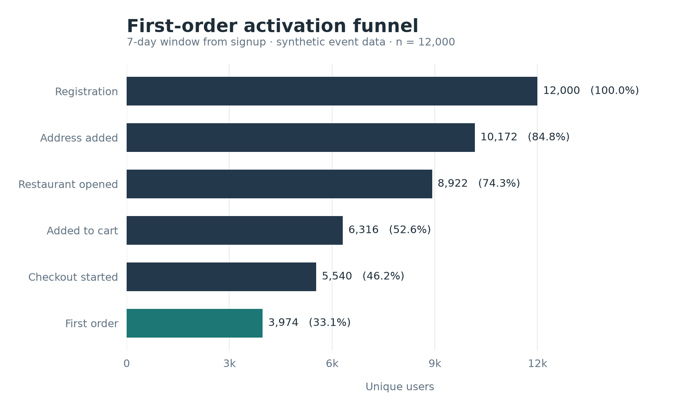
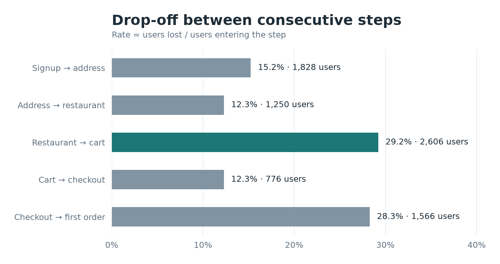
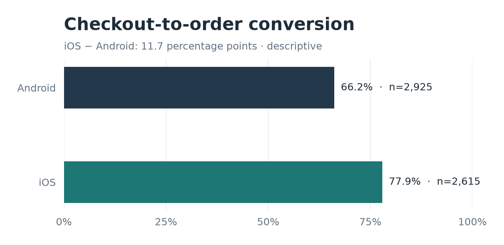
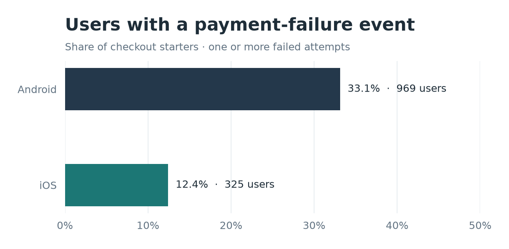
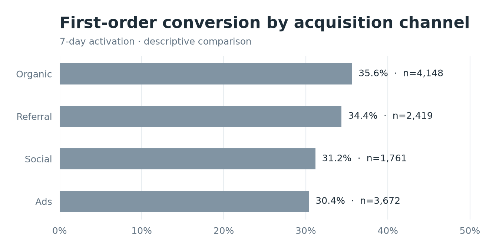

# Анализ воронки первого заказа в сервисе доставки еды

[](https://github.com/uzavvrit/food-delivery-activation-analysis/actions/workflows/ci.yml)

**Стек:** Python (pandas, matplotlib), SQL (SQLite), pytest.

## О проекте

Анализ пути пользователя от регистрации до первого заказа в приложении доставки еды. Цель – оценить конверсию на каждом этапе, выявить основные потери, сравнить поведение пользователей на разных платформах и сформулировать гипотезы для дальнейшей продуктовой проверки.

**Данные:** 12 000 пользователей, синтетический событийный лог. Набор данных воспроизводимо генерируется кодом проекта; различия между сегментами заложены в модели. Результаты отражают учебный сценарий, а не показатели реальной компании.

## Ключевые результаты

- **Активация за 7 дней:** первый заказ совершили **3 974 из 12 000 пользователей (33,1%)**.
- **Наибольшая абсолютная потеря:** между просмотром ресторана и добавлением блюда в корзину – **2 606 пользователей**.
- **Конверсия из checkout в первый заказ:** **66,2% на Android** против **77,9% на iOS** (разница **11,7 п.п.**).
- **Ошибки оплаты:** событие `payment_failed` зафиксировано у **33,1% пользователей Android** и **12,4% пользователей iOS**, начавших оформление заказа.

Различие между платформами указывает на направление для диагностики, но само по себе не подтверждает причинную связь между ошибками оплаты и конверсией.

[Аналитический отчёт](reports/analysis_report.md) · [Методология](docs/methodology.md) · [Словарь данных](docs/data_dictionary.md)

## Визуализация результатов

### Воронка от регистрации до первого заказа



### Потери между этапами воронки



### Конверсия checkout по платформам



### Частота событий ошибок оплаты



### Конверсия по каналам привлечения



## Исследовательские вопросы

| Вопрос | Подход |
|---|---|
| Какая доля зарегистрированных пользователей совершает первый заказ? | Последовательная воронка и общая конверсия |
| На каких этапах теряется больше всего пользователей? | Пошаговая конверсия и абсолютный drop-off |
| Как различается поведение пользователей? | Сегментация по платформе и каналу привлечения |
| С чем может быть связан низкий checkout conversion на Android? | Сопоставление конверсии и событий `payment_failed` |
| Какая доля клиентов делает повторный заказ? | Кумулятивная повторная покупка за 7 и 30 дней |

## Данные и методология

- **Период регистраций:** январь – март 2026 года; дата окончания наблюдения – 15 мая 2026 года (UTC).
- **Единица анализа:** уникальный пользователь (`user_id`), а не число событий.
- **Этапы воронки:** `signup → address_added → restaurant_opened → added_to_cart → checkout_started → order_completed`.
- Каждый следующий этап учитывается только после предыдущего и в пределах **7 дней с момента регистрации**.
- Для оценки повторной покупки используются только пользователи, совершившие первый заказ. Показатели за 7 и 30 дней кумулятивные, а не retention ровно на соответствующий день.

Подробные определения событий, правила расчёта и ограничения приведены в [методологии](docs/methodology.md).

## Инструменты

- **SQL (SQLite):** построение пользовательской воронки, CTE, агрегирование, оконные функции `LAG` и `FIRST_VALUE`, проверки качества данных.
- **Python:** генерация событий, проверка и обработка результатов в `pandas`, построение графиков в `matplotlib`.
- **pytest:** автоматические проверки ключевых расчётов и воспроизводимости.

## Структура репозитория

```text
.
├── data/sample/             # примеры входных данных
├── docs/                    # описание полей и методология
├── reports/
│   ├── analysis_report.md   # результаты и рекомендации
│   ├── validation_report.md # проверка расчётов
│   ├── figures/             # графики
│   └── tables/              # итоговые таблицы
├── scripts/                 # генерация данных, расчёты и визуализации
├── sql/                     # запросы для расчёта метрик
├── tests/                   # автоматические тесты
├── .github/workflows/ci.yml # автоматические тесты и пересчёт отчёта
├── Makefile
├── requirements.txt
└── README.md
```

## Воспроизведение анализа

Требуется **Python 3.10+**. Из корня репозитория:

```bash
python -m pip install -r requirements.txt
python -m scripts.run_all
python -m pytest -q
```

Запуск генерирует исходные данные в `data/raw/`, рассчитывает метрики и обновляет таблицы, графики и аналитический отчёт. Для генерации используется фиксированный `seed = 20261029`, что позволяет воспроизвести результаты при одинаковой среде выполнения.

## Выводы и дальнейшие шаги

**Ресторан → корзина.** На этом переходе наблюдается наибольшая абсолютная потеря пользователей. Для определения причин необходимы дополнительные данные о выборе блюд, ценах, условиях доставки и доступности ресторанов.

**Оплата на Android.** Более низкая конверсия checkout и повышенная частота `payment_failed` позволяют сформулировать диагностическую гипотезу. Следующий шаг – проверить качество платёжного логирования, добавить разрезы по методам оплаты, кодам ошибок и версиям приложения, затем оценить возможное улучшение с помощью A/B-теста.

Приоритеты продуктовых изменений следует определять с учётом потенциального эффекта, стоимости реализации и качества подтверждающих данных.

### Ограничения

Исследование основано на **синтетических данных**: сегментные различия заданы генератором и не являются эмпирическим доказательством причинных эффектов. **A/B-тест не проводился** – в проекте представлен план его проверки. Без данных о выручке, марже и стоимости изменений нельзя оценить экономическую отдачу предложенных инициатив.
