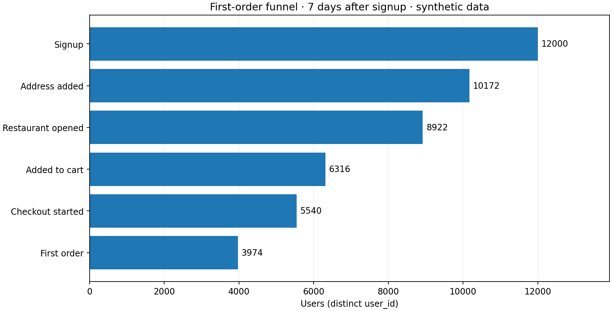
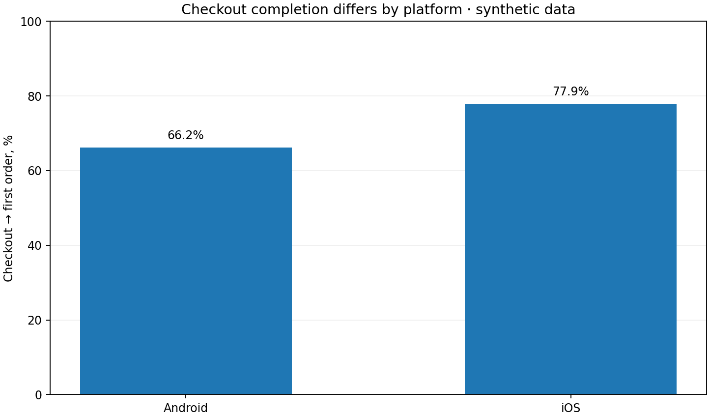
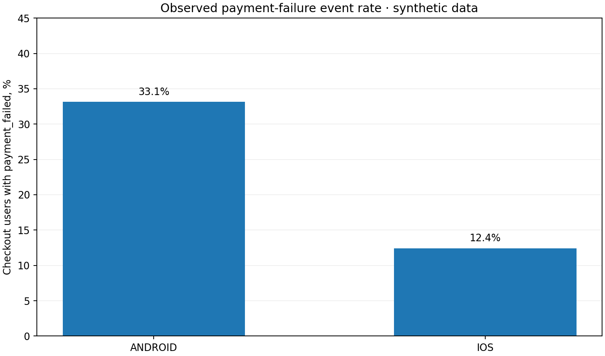

# Аналитический отчёт: воронка первого заказа

> **Источник:** воспроизводимые **синтетические** события, созданные кодом `scripts/generate_data.py` (seed 20261029). Не реальные данные компании и не рыночная статистика. Встроенные вероятности специально создают различия платформ и каналов.

## 1. Продуктовая задача

Руководитель продукта доставки еды хочет понять, сколько новых пользователей делают первый заказ в течение 7 дней регистрации и где в пути теряются пользователи. Задача аналитика — рассчитать воронку, найти диагностические различия и предложить следующие измерения и эксперимент.

## 2. Короткий вывод

- Регистраций: **12,000**; завершили первый заказ: **3,974** (**33.1%**).
- Крупнейшая абсолютная потеря на переходе **Restaurant opened → Added to cart**: **2,606 пользователей**. Это не обязательно самая легко исправимая проблема.
- Конверсия **checkout → first order**: **66.2% на Android**, **77.9% на iOS** (разница **11.7 п.п.** в пользу iOS; приближённый 95% ДИ разницы: **[9.4; 14.1] п.п.**).
- Событие `payment_failed` среди начавших checkout: **33.1% Android** и **12.4% iOS**. Это диагностическая корреляция в симуляции, не доказательство причинности в реальном продукте.

## 3. Воронка

Деноминатор для общей конверсии — **все зарегистрированные**; для конверсии шага — **дошедшие до предыдущего шага**. Строки — уникальные пользователи, а не количество событий.

| Шаг | Пользователей | От регистраций | От предыдущего шага | Потеря пользователей |
|---|---:|---:|---:|---:|
| Signup | 12,000 | 100.0% | — | — |
| Address added | 10,172 | 84.8% | 84.8% | 1,828 |
| Restaurant opened | 8,922 | 74.3% | 87.7% | 1,250 |
| Added to cart | 6,316 | 52.6% | 70.8% | 2,606 |
| Checkout started | 5,540 | 46.2% | 87.7% | 776 |
| First order | 3,974 | 33.1% | 71.7% | 1,566 |

## 4. Проверка платформ

На Android доля зафиксированных ошибок оплаты выше, а завершение оформления заказа ниже. **Гипотеза:** некоторым пользователям Android сложнее успешно оплатить заказ. **Нельзя заключить**, что события ошибок объясняют всю разницу: не учтены типы банковских карт, версии приложения, цена заказа, интернет-соединение, промокоды и другие факторы. Для проверки нужны логи ошибок, методы оплаты и контрольный эксперимент.

## 5. Возврат за повторной покупкой (вторичная метрика)

Из **3,974** пользователей с первым заказом повторили покупку **753 (18.9%)** за 7 дней и **1,581 (39.8%)** за 30 дней. Это **кумулятивный repeat purchase**, не классический exact-day retention на D7/D30. Полное окно наблюдения есть у всех покупателей (см. methodology).

## 6. Что рекомендовать продукту

1. **Проверить качество событий:** что значит `payment_failed`, нет ли потерь логирования по платформам, нет ли повторов.
2. **Разбить checkout Android по версии приложения, методу оплаты и кодам ошибок**, чтобы найти конкретный механизм (если появятся такие поля).
3. **Провести качественное исследование** (сессии/интервью) пользователей, не завершивших оплату.
4. **Проверить исправление через A/B-тест:** Android-пользователи, начавшие checkout; рандомизация по `user_id`; основная метрика — доля завершивших первый заказ из начавших checkout; guardrails — платёжные ошибки и отмены, стоимость обработки платежей. Срок и размер выборки рассчитать до запуска по MDE/мощности.

**Простая оценка масштаба, не прогноз:** при гипотетическом росте Android checkout-конверсии на **5 п.п.** это дало бы около **146** дополнительных первых заказов на таком же объёме checkout. Здесь НЕ оценен реальный эффект и НЕ заявлено, что он достижим.

## 7. Проверки и ограничения

- Проверено шесть типов ошибок качества данных, каждое количество = 0.
- Проверена последовательность событий и окно 7 дней; все шаги вложены друг в друга.
- Счётчики SQL сверены независимо через `pandas`.
- **Ограничения:** синтетические данные; нет пользовательского эксперимента; не показана выручка; поля ошибок намеренно упрощены; сегментные сравнения описательные и не причинные.

Таблицы с расчётами: [`tables/`](tables/). Определения: [`../docs/methodology.md`](../docs/methodology.md). SQL: [`../sql/`](../sql/).
